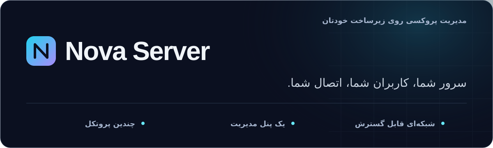

<div align="center" dir="rtl">

<strong>فارسی</strong> | <a href="README.md">⁦English⁩</a>



**راهکاری برای مدیریت سرور پروکسی، متناسب با شبکه‌های محدودشده.**

چندین پروتکل پروکسی را روی سرور خودتان اجرا کنید، کاربران و سرورها را مدیریت کنید و از یک پنل،
اشتراک شخصی در اختیار کاربران بگذارید. طراحی‌شده با توجه به شرایط اینترنت ایران،
با رابط انگلیسی، فارسی و روسی.

[](https://github.com/IRNova/Nova-Server/releases/latest)
[](LICENSE)
[](https://github.com/IRNova/Nova-Server/stargazers)

[نصب](#quick-install) | [امکانات](#features) | [راهنمای مدیریت](GUIDE.md) | [یادداشت‌های انتشار](RELEASE_NOTES.fa.md) | [ارتباط با ما](#community)

</div>

<div dir="rtl">

---

<a id="what-is-nova-server"></a>

## نوا سرور چیست؟

نوا سرور یک سرور مجازی لینوکسی را به سرویس پروکسی اختصاصی شما تبدیل می‌کند.
یک ایجنت، ⁦Xray-core⁩، ⁦sing-box⁩، ⁦AmneziaWG⁩ و سرویس‌های مستقل اختیاری را در کنار
پنل وب، ⁦REST API⁩ و ربات تلگرام مدیریت می‌کند. می‌توانید با یک سرور و یک حساب شخصی
شروع کنید یا مجموعه‌ای از سرورها را همراه با پلن‌های مشتری و دسترسی نمایندگان اداره کنید.

**نوا سرور نرم‌افزاری اختصاصی و متن‌بسته است.** این مخزن عمومی، بسته‌های انتشار،
نصب‌کننده‌ها و مستندات را ارائه می‌کند و شامل کد منبع سرور نیست.
[⁦Nova Proxy⁩](https://github.com/IRNova/Nova-Proxy)، پروژهٔ جداگانهٔ مبتنی بر
⁦Cloudflare Worker⁩، متن‌باز است.

- **انتخاب شیوهٔ اتصال:** ⁦VLESS⁩ با ⁦Reality⁩، ⁦VMess⁩، ⁦Trojan⁩، ⁦Shadowsocks⁩،
  ⁦Hysteria2⁩، ⁦TUIC⁩، ⁦NaiveProxy⁩، ⁦WireGuard⁩ و ⁦AmneziaWG⁩، همراه با
  ⁦mieru⁩ و ⁦MTProto⁩ تلگرام به‌صورت اختیاری. پروتکل و روش انتقال را بر اساس
  برنامه‌ای که کاربران دارند انتخاب کنید.
- **راه‌اندازی هدایت‌شده:** دستیار راه‌اندازی، حساب آغازین، لینک اشتراک شخصی و کد
  ⁦QR⁩ به شروع کار کمک می‌کنند. نمای ساده و پیشرفته در همان پنل در دسترس‌اند.
- **مدیریت کاربران و نمایندگان:** سقف حجم، انقضا، محدودیت دستگاه، پلن‌های ذخیره‌شده،
  عملیات گروهی با پیش‌نمایش، ورود و خروج ⁦CSV⁩ و دسترسی جداگانه برای هر کاربر.
- **یک پنل برای چند سرور:** نودها را با دستور ساخته‌شده در پنل اضافه کنید، ورودی‌های
  پشتیبانی‌شده را روی آن‌ها قرار دهید و نشانی نودها و پل‌های سازگار را به‌عنوان مسیر
  جایگزین در اشتراک منتشر کنید. مدیریت ⁦AmneziaWG⁩ روی نودهای سازگار نیز ممکن است.
- **گزینه‌هایی برای شبکه‌های محدودشده:** تونل پل ایران، آی‌پی تمیز کلادفلر، گزینه‌های
  فرگمنت سمت کلاینت و ⁦ECH⁩ در برنامه‌های سازگار و سه موتور تونل ⁦DNS⁩.
  دسترسی واقعی به شبکه، تنظیمات و کلاینت بستگی دارد.
- **تحویل شخصی به کاربر:** صفحهٔ مشتری با میزان مصرف و لینک افزودن به برنامه،
  یکپارچگی با ⁦Nova Client⁩، لینک ⁦MTProto⁩ تلگرام و لینک شخصی پروکسی وب تلگرام
  با امکان استفاده از ⁦CDN⁩. این‌ها سرویس‌های جداگانه با نیازهای کلاینت متفاوت‌اند.
- **ابزارهای مدیریت روزمره:** چند دامنه، صدور و تمدید گواهی، بررسی سلامت، پشتیبان‌گیری،
  نمودار ترافیک، وب‌هوک امضاشده، نگهبان ورود، احراز هویت دومرحله‌ای و بستهٔ پشتیبانی
  قابل بازبینی پیش از اشتراک‌گذاری.

درگاه ⁦HTTPS⁩ می‌تواند پورت ⁦TCP 443⁩ را میان سرویس‌های سازگار به اشتراک بگذارد.
پروتکل‌های ⁦UDP⁩، ⁦WireGuard/AmneziaWG⁩، تونل ⁦DNS⁩ و سرویس‌های مستقل ممکن است
به پورت‌های جداگانه نیاز داشته باشند. هیچ پروتکل یا تنظیمی عبور از تمام محدودیت‌های
شبکه را تضمین نمی‌کند.

---

<a id="quick-install"></a>

## نصب سریع


روی یک سرور تازه اوبونتو ۲۰.۰۴ به بالا یا دبیان ۱۱ به بالا (⁦x86_64⁩ یا ⁦arm64⁩) این دستور را اجرا کنید:

```bash
bash <(curl -fsSL https://raw.githubusercontent.com/IRNova/Nova-Server/main/nova-node.sh)
```

نصب‌کننده اول چند سؤال کوتاه می‌پرسد:

- **دامنه**: اگر دامنه دارید، به‌صورت خودکار یک گواهی رایگان ⁦Let's Encrypt⁩ برایش گرفته می‌شود. اگر دامنه ندارید هم مشکلی نیست: نود روی آی‌پی خودش با یک گواهی ⁦self-signed⁩ کار می‌کند و اپلیکیشن ⁦Nova⁩ در هر دو حالت به آن وصل می‌شود.
- **مسیر مخفی پنل**: با زدن ⁦Enter⁩ یک مسیر تصادفی ساخته می‌شود، می‌توانید مسیر دلخواه خودتان را بنویسید، یا با ⁦`none`⁩ پنل را روی ریشه نگه دارید.
- **پورت اضافی پنل**: در صورت تمایل، یک پورت ⁦HTTPS⁩ جداگانه برای پنل (مثلاً ⁦`2053`⁩). پورت در فایروال به‌صورت خودکار باز می‌شود.

سپس هسته‌های پروکسی، پنل و بک‌اند‌های تونل راه‌اندازی می‌شوند، همهٔ پروتکل‌های استاندارد در دسترس روشن می‌شوند و یک کاربر آغازین با نام ⁦`me`⁩ ساخته می‌شود. آدرس چاپ‌شدهٔ پنل را باز کنید و با رمز مدیریتی که نصب‌کننده نشان می‌دهد وارد شوید. آدرس و رمز را خصوصی نگه دارید.

**دستیار راه‌اندازی** در اولین بازدید از پنل باز می‌شود. تنظیمات پیشنهادی را پیش از اعمال بازبینی کنید و در صورت نیاز مراحل دامنه، پل یا نود را دنبال کنید. داشبورد برای حساب آغازین شما لینک اشتراک شخصی و کد ⁦QR⁩ دارد.

یک نود تازه در **حالت ساده** شروع می‌کند: صفحه‌های روزمره روی صفحه می‌مانند و جزئیات داخلی موتور کنار گذاشته می‌شوند، چون دستیار آن‌ها را برایتان تنظیم می‌کند. یک کلید در **تنظیمات ← نمایش صفحه‌های پیشرفته** سازندهٔ قوانین مسیریابی، خروجی‌های سفارشی، تونل‌ها، گزینه‌های موتور ⁦Xray⁩، نمایندگان و توکن‌های ⁦API⁩ را برمی‌گرداند. این کلید هیچ تنظیمی را عوض نمی‌کند و فقط تعیین می‌کند چه صفحه‌هایی فهرست شوند، و نودی که پیش از این نسخه وجود داشته همهٔ صفحه‌هایش را نگه می‌دارد.

برای نصب اسکریپتی (بدون سؤال)، همه‌چیز را با متغیرهای محیطی تنظیم کنید: ⁦`NOVA_DOMAIN`⁩، ⁦`NOVA_DOMAIN_EMAIL`⁩، ⁦`NOVA_PANEL_PATH`⁩ (یا ⁦`none`⁩)، ⁦`NOVA_PANEL_PORT`⁩، ⁦`NOVA_ADMIN_PASS`⁩ و برای رد شدن از همه سؤال‌ها ⁦`NOVA_NO_PROMPT=1`⁩.

آدرس پنل یا مسیر مخفی را گم کرده‌اید؟ روی سرور ⁦`nova-access`⁩ را اجرا کنید.
این دستور آدرس فعلی را بدون تغییر رمز یا احراز هویت دومرحله‌ای نشان می‌دهد.

رمز را فراموش کرده‌اید؟ از روی سرور آن را بازنشانی کنید:

```bash
nova-passwd 'YourNewPassword'
```

فقط اگر دسترسی به برنامهٔ رمزساز را هم از دست داده‌اید، گزینهٔ ⁦`--clear-2fa`⁩ را
به دستور بازنشانی رمز اضافه کنید. این کار محافظت دومرحله‌ای را حذف می‌کند؛
پس از ورود دوباره آن را فعال کنید.

پنل بعد از تغییر دامنه، ⁦Cloudflare⁩ یا ⁦SSL⁩ جواب نمی‌دهد؟ دسترسی را از روی سرور و بدون پنل بازیابی کنید. این دستور آدرس فعلی پنل را چاپ می‌کند و ⁦`--reset`⁩ نود را به حالت ⁦self-signed⁩ بدون دامنه برمی‌گرداند (همه‌چیز به آی‌پی سرور برمی‌گردد):

```bash
nova-access            # نمایش آدرس فعلی پنل و حالت TLS
nova-access --reset    # بازگشت به نود self-signed بدون دامنه
```

### پنل پشت مسیر مخفی

پیش از این، پنل مستقیماً روی ریشه (⁦`https://server/`⁩) جواب می‌داد. حالا هر نصب تازه پنل را پشت یک زیرمسیر مخفی تصادفی مثل ⁦`https://server/p-a1b2c3/`⁩ قرار می‌دهد و هر مسیر دیگری فقط یک ۴۰۴ ساده برمی‌گرداند؛ این کار پیدا کردن اتفاقی پنل را دشوارتر می‌کند و جایگزین رمز قوی، احراز هویت دومرحله‌ای یا قوانین فایروال نیست. هر وقت خواستید می‌توانید در **تنظیمات > عمومی > دسترسی پنل** مسیر را عوض کنید، آن را پاک کنید تا پنل به ریشه برگردد، یا یک پورت ⁦HTTPS⁩ جداگانه (مثلاً ⁦`2053`⁩) به پنل بدهید؛ پورت فایروال به‌صورت خودکار باز می‌شود.

### چند دامنه، زیردامنه، پل و نود

در پنل بخش **دامنه‌ها و آدرس‌ها** را باز کنید. کارت اول یک دامنهٔ اصلی پنل را مدیریت می‌کند. در کارت **دامنه‌های اضافه** می‌توانید تا ۲۰ دامنه یا زیردامنهٔ دیگر برای همان سرور ثبت کنید:

1. دامنه را به این ⁦VPS⁩ اشاره دهید، یا ⁦Cloudflare⁩ را وصل کنید تا نوا رکورد ⁦DNS⁩ را بسازد.
2. دریافت خودکار گواهی با ⁦Let's Encrypt⁩، دریافت خودکار با ⁦DNS⁩ کلادفلر، یا واردکردن گواهی موجود را انتخاب کنید.
3. گزینهٔ **همهٔ پروتکل‌های سازگار** را انتخاب کنید، یا برای آدرس ابر نارنجی کلادفلر از **فقط ⁦WebSocket⁩ اصلی** استفاده کنید.
4. نوا پیش از افزودن دامنه به اشتراک کاربران، گواهی و بارگذاری امن ⁦Xray⁩ را بررسی می‌کند. دامنهٔ در انتظار یا ناموفق هیچ‌وقت منتشر نمی‌شود.

دامنهٔ اضافهٔ سرور، آدرس پل ایران نیست. دامنهٔ پل باید به ⁦VPS⁩ ایران اشاره کند و در **تونل > دامنه‌های پل** قرار بگیرد. دامنهٔ نود مدیریت‌شده باید به ⁦VPS⁩ نود جدید اشاره کند و پیش از ساخت دستور تک‌خطی در صفحهٔ **نودها** وارد شود.

پروتکل‌های ⁦Xray⁩ می‌توانند گواهی هر دامنه را بر اساس ⁦SNI⁩ انتخاب کنند. ⁦Hysteria2⁩، ⁦TUIC⁩ و ⁦NaiveProxy⁩ از یک گواهی سرور در ⁦sing-box⁩ استفاده می‌کنند، پس نوا فقط وقتی این آدرس‌ها را برای آن پروتکل‌ها اضافه می‌کند که گواهی ⁦wildcard⁩ اصلی کلادفلر زیردامنه را پوشش دهد. در غیر این صورت آن پروتکل‌ها با امنیت کامل روی دامنهٔ اصلی می‌مانند.

---

## تازه‌کارید؟ راهنمای گام‌به‌گام

تا حالا سرور راه نینداخته‌اید؟ این کل مسیر است، با گام‌های ساده. هر کلمهٔ فنی، اولین بار که می‌آید توضیح داده می‌شود.

1. **یک ⁦VPS⁩ بگیرید.** ⁦VPS⁩ یک کامپیوتر کوچک است که روی اینترنت اجاره می‌کنید و همیشه روشن است، تا کاربران بتوانند شبانه‌روز به آن وصل شوند. هر ارائه‌دهنده‌ای کار می‌کند؛ یک ⁦Ubuntu 20.04+⁩ یا ⁦Debian 11+⁩ ساده (حدود ۴ تا ۶ دلار در ماه) کافی است. برای شروع به دامنه **نیاز ندارید**.

2. **⁦Nova⁩ را نصب کنید (فقط یک راه را انتخاب کنید).**
   - **یک دستور:** ترمینال سرورتان را باز کنید (اگر تا حالا از ⁦SSH⁩ استفاده نکرده‌اید، که فقط راهی برای تایپ‌کردن دستور روی سرور است، بیشتر ارائه‌دهنده‌ها یک دکمهٔ ⁦Console⁩ در مرورگر دارند)، دستور بخش «نصب سریع» را بچسبانید و ⁦Enter⁩ بزنید. چند سؤال ساده می‌پرسد؛ زدن ⁦Enter⁩ برای پذیرفتن پیش‌فرض‌ها کافی است.
   - **بدون رایانه:** همان دستور را هنگام ساخت سرور در کادر ⁦cloud-init⁩ یا ⁦user data⁩ ارائه‌دهنده بچسبانید.
   - **تلگرام:** ربات نصب‌کننده می‌تواند همه‌چیز را برایتان انجام دهد.

3. **پنل را باز کنید و وارد شوید.** نصب‌کننده آدرس پنل شما را چاپ می‌کند، شامل یک مسیر مخفی، پس آن لینک را ذخیره کنید. با رمز مدیریتی که نصب‌کننده نشان می‌دهد وارد شوید. لینک را گم کردید؟ روی سرور دستور ⁦nova-access⁩ را اجرا کنید تا آدرس فعلی را بدون تغییر رمز چاپ کند.

4. **(اختیاری) یک دامنه و ⁦HTTPS⁩ رایگان اضافه کنید.** دامنه (یک نشانی وب مثل ⁦vpn.example.com⁩) و گواهی معتبر ⁦TLS⁩ برای اتصال پایهٔ پروکسی اختیاری هستند. بدون آن‌ها، نود شما روی ⁦IP⁩ کار می‌کند و اپ ⁦Nova⁩ باز هم وصل می‌شود. با یک دامنه، پنل به‌صورت خودکار یک گواهی رایگان می‌گیرد. می‌توانید این مرحله را رد کنید و بعداً اضافه کنید.

5. **اسکن کنید و وصل شوید.** ⁦Nova⁩ از قبل کاربر آغازین ⁦`me`⁩ را با دسترسی به همهٔ پروتکل‌های در دسترس و ورودی‌های عمومی ساخته است. در داشبورد اصلی کارت «اتصال سریع» را پیدا کنید و کد ⁦QR⁩ اشتراک شخصی را با ⁦Nova⁩، ⁦v2rayNG⁩، ⁦sing-box⁩ یا ⁦Clash⁩ اسکن کنید. همان لینک خودبه‌روزرسان را هم می‌توانید کپی کنید. وقتی محدودیت یا دسترسی جداگانه می‌خواهید، بعداً کاربران بیشتری بسازید.

6. **هر وقت لازم شد، جلوتر بروید.** کاربران بیشتری اضافه کنید و محدودیت حجم یا زمان بگذارید، در صفحهٔ ورودی‌ها نقاط ورود بیشتری اضافه کنید، زیر فیلترینگ سنگین با پل ایران یا تونل ⁦DNS⁩ آنلاین بمانید، و از یک پنل به چند سرور (نود) گسترش دهید.

خودِ پنل یک راهنمای **راه‌اندازی گام‌به‌گام** مفصل‌تر هم به‌صورت داخلی دارد (بالای راهنمای داخل پنل)، به انگلیسی، فارسی و روسی.

---

## نصب با ⁦Docker⁩

کانتینر را ترجیح می‌دهید؟ ⁦Nova⁩ یک گزینه ⁦Docker⁩ هم دارد که جایگزینی برای نصب‌کننده بومی تک‌خطی است. تکرارپذیر است، توقف و جابه‌جایی و ارتقایش آسان است و داده‌های شما روی والیوم‌های نام‌دار می‌ماند و پس از بازسازی هم باقی می‌ماند. نصب‌کننده و بستهٔ عامل با ⁦checksum⁩ پین‌شده داخل ایمیج قرار دارند و کانتینر بازسازی‌شده محیط اجرا را بدون از دست رفتن پایگاه داده یا گواهی‌های پایدار برمی‌گرداند.

این دستور را روی یک ⁦VPS⁩ واقعی لینوکس با کاربر ⁦root⁩ اجرا کنید. اگر ⁦Docker⁩ نصب نباشد آن را نصب می‌کند، ایمیج را می‌سازد و نود را بالا می‌آورد:

```bash
bash <(curl -fsSL https://raw.githubusercontent.com/IRNova/Nova-Server/main/docker/nova-docker.sh)
```

همان گزینه‌های نصب‌کننده بومی را دارید که با متغیرهای محیطی داده می‌شوند: ⁦`NOVA_ADMIN_PASS`⁩، ⁦`NOVA_DOMAIN`⁩، ⁦`NOVA_PANEL_PATH`⁩ و ⁦`NOVA_PANEL_PORT`⁩.

بعد از بالا آمدن، رمز ساخته‌شده و آدرس پنل را با این دستور پیدا کنید:

```bash
cd /opt/nova-docker/docker && docker compose logs -f nova-node
```

**مهم:** این روش به یک هاست واقعی لینوکس با شبکه هاست (⁦host networking⁩) نیاز دارد. روی ⁦Docker Desktop⁩ مک یا ویندوز کار **نمی‌کند**، چون آن‌ها نمی‌توانند پورت ⁦`443`⁩ هاست را آن‌طور که یک نود لازم دارد بگیرند. کانتینر داخل خودش ⁦systemd⁩ را اجرا می‌کند و از شبکه هاست به‌همراه حالت ⁦privileged⁩ استفاده می‌کند، چون یک نود ⁦Nova⁩ یک دستگاه ⁦VPN⁩ است: پورت ⁦`443`⁩ (روی ⁦TCP⁩ و ⁦UDP⁩)، و در صورت نیاز ⁦`53/udp`⁩ و یک پورت ⁦UDP⁩ برای ⁦WireGuard⁩ را می‌گیرد و سرویس‌های ⁦systemd⁩ را مدیریت می‌کند. جزئیات کامل در ⁦`docker/README.md`⁩ هست.

---

<a id="iran-bridge"></a>

## تونل پل ایران

پل ایران یک نشانی محلی در اختیار کاربران می‌گذارد که ترافیک را به سرور خروجی خارج
از کشور منتقل می‌کند. این روش به سروری جداگانه با نشانی قابل دسترس و مسیر سالم
تا سرور خروجی نیاز دارد.

- از **⁦Backhaul⁩**، **⁦BackPack⁩**، **⁦rathole⁩** یا **⁦wstunnel⁩** استفاده کنید.
- در اشتراک خام، ⁦Clash⁩ و ⁦sing-box⁩ فقط پورت‌های فورواردشده از پل عبور می‌کنند.
  با فوروارد کردن تنها ⁦TCP 443⁩، بقیهٔ پروتکل‌ها مستقیم می‌مانند.
- پروتکل‌های ⁦UDP⁩ مانند ⁦Hysteria2⁩ به فوروارد جداگانهٔ ⁦UDP⁩ و تنظیمات سازگار
  بک‌اند نیاز دارند؛ فوروارد ⁦TCP⁩ به‌تنهایی آن‌ها را منتقل نمی‌کند.
- چند نشانی پل، مسیرهای جایگزین برای کلاینت‌های سازگار فراهم می‌کند.
  جابه‌جایی خودکار به شیوهٔ انتخاب و بررسی سلامت در کلاینت بستگی دارد.
- بررسی آمادگی با ⁦`nova-bridge.sh --check`⁩ نشانی عمومی و پورت‌های آزاد را بررسی
  می‌کند. آزمون پورت کنترل و عیب‌یابی تونل نیز در پنل در دسترس است.

---

### تونل ⁦DNS⁩ برای اتصال جایگزین

تونل ⁦DNS⁩ گزینه‌ای اختیاری برای زمانی است که اتصال‌های معمول در دسترس نیستند اما
هنوز مسیر ⁦DNS⁩ قابل استفاده‌ای وجود دارد. سرعت و دسترسی به شبکه بستگی دارند؛
این روش جایگزین یک اتصال معمولی ⁦VPN⁩ با ظرفیت بالا نیست.

در صفحهٔ **تونل ⁦DNS⁩** یکی از موتورهای زیر را انتخاب کنید:

- **⁦MasterDnsVPN⁩:** گزینهٔ پیش‌فرض ساده با پیکربندی جداگانهٔ کلاینت.
- **⁦CottenDns⁩:** انتقال از طریق ⁦DoT/DoH⁩، چند حل‌کنندهٔ نام و بازیابی افت بسته.
- **⁦Soar⁩:** تونل ⁦DNS⁩ از تیم ⁦Lantern⁩، با حالت اشتراکی یا جداگانه برای هر مشتری.
  در حالت جداگانه، هر مشتری دارای دسترسی، کلید و محاسبهٔ مصرف مستقل دارد.
  ⁦Soar⁩ فقط ⁦TCP⁩ را منتقل می‌کند و مقصدهای پیش‌فرض آن پورت‌های ۸۰ و ۴۴۳ هستند.

در هر لحظه فقط یک موتور از درگاه ⁦DNS⁩ استفاده می‌کند. راه‌اندازی به زیردامنه‌ای
با رکورد ⁦`NS`⁩ واگذارشده به نود و دسترسی به پورت ⁦UDP 53⁩ نیاز دارد. نوا می‌تواند
این واگذاری را از طریق کلادفلر بسازد یا می‌توانید راهنمای دستی رکوردهای ⁦`A`⁩ و ⁦`NS`⁩ را دنبال کنید.

کلاینت باید با موتور انتخاب‌شده سازگار باشد. برای دریافت ⁦Soar⁩ در اشتراک شخصی،
از **⁦Nova Client⁩ با شمارهٔ ساخت ۲۳۸ یا جدیدتر** و پشتیبانی ⁦Soar⁩ استفاده کنید.
صفحهٔ مشتری لینک مستقیم پروفایل و کد ⁦QR⁩ نیز دارد. ⁦MasterDnsVPN⁩ و ⁦CottenDns⁩
از کلاینت و پیکربندی خروجی مخصوص خود استفاده می‌کنند. اشتراک‌های عمومی ⁦Clash⁩ و
⁦sing-box⁩ شامل ⁦Soar⁩ نیستند.


---

<a id="add-nodes"></a>

## مدیریت چند سرور


دیگر لازم نیست روی هر سرور یک پنل کامل نصب کنید. پنل را یک بار روی سرور اصلی نصب کنید و ناوگان را از همان‌جا گسترش دهید:

1. در پنل اصلی، صفحه **نودها** را باز کنید و روی **افزودن نود با یک دستور** بزنید. در صورت تمایل دامنه‌ای را که از قبل به ⁦VPS⁩ جدید اشاره می‌کند وارد کنید؛ نوا هنگام اتصال، گواهی ⁦Let's Encrypt⁩ آن را می‌گیرد و تمدید می‌کند.
2. تک‌خطی را که به شما می‌دهد روی یک ⁦VPS⁩ تازه اجرا کنید:

```bash
NOVA_JOIN_URL='https://your-panel' NOVA_JOIN_TOKEN='njt_...' bash <(curl -fsSL https://raw.githubusercontent.com/IRNova/Nova-Server/main/nova-node.sh)
```

سرور جدید در حالت **نود مدیریت‌شده** نصب می‌شود: پنل مستقلی ندارد (فقط یک صفحه ساده، بدون امکان ورود)، خودش را به‌صورت خودکار به پنل اصلی معرفی می‌کند و از آن به بعد همه‌چیز (کاربران، ترافیک، همه‌چیز) از داخل پنل اصلی و از طریق ⁦API⁩ نود کنترل می‌شود. توکن اتصال یک‌بارمصرف است و بعد از ۲۴ ساعت منقضی می‌شود. این کار چه نود دامنه داشته باشد و چه روی یک ⁦IP⁩ ساده با گواهی خودامضا اجرا شود، کار می‌کند. هنگام ثبت‌نام، نود توکن دسترسی‌اش را روی یک اتصال ⁦TLS⁩ تأییدشده به پنل می‌فرستد و اگر خودِ پنل گواهی خودامضا داشته باشد، نود کلید پنل را هم پین می‌کند، پس توکن در مسیر قابل‌شنود نیست. (اگر گواهی پنل را عوض یا نو کردید، یک دستور «افزودن نود» تازه بسازید.)

**اگر ثبت‌نام کامل نشود**، چیزی از دست نمی‌رود. اگر پنل اصلی نتواند به نود جدید برسد (معمولاً چون پورت ۴۴۳ روی آن هنوز به‌روی اینترنت باز نیست)، نود در صفحهٔ **نودها** با وضعیت **در انتظار** و همراه دلیلش نمایش داده می‌شود و آن تلاش در گزارش فعالیت ثبت می‌شود. پورت ۴۴۳ را روی آن سرور باز کنید و «تست» را بزنید، یا دستی اضافه‌اش کنید. اگر یک نود در ثبت‌نام ناموفق بماند، **قفل نمی‌شود**: به‌صورت یک پنل مستقل عادی باقی می‌ماند تا بتوانید دوباره تلاش کنید یا مدیریتش کنید، و هرگز بلااستفاده رها نمی‌شود.

**کاربران و پروتکل‌ها مرکزی‌اند و روی نودها قرار می‌گیرند.** شما هیچ‌وقت مستقیم یک نود را مدیریت نمی‌کنید. کاربرها را در صفحهٔ **کاربران** و پروتکل‌ها را در صفحهٔ **ورودی‌ها** مثل همیشه بسازید، و هنگام افزودن یک پروتکل با «اجرا روی» انتخاب کنید: این سرور اصلی، یک نود، یا **همهٔ نودها**. پنل آن پروتکل و کاربران اختصاص‌یافته‌اش را به نود(های) انتخاب‌شده می‌فرستد و کانفیگ اشتراک هر کاربر از **آی‌پی همان نود** استفاده می‌کند تا از طریق آن وصل شود. در صفحهٔ **کاربران** انتخاب می‌کنید هر کاربر کدام نودها را بگیرد: زیر **نودهای این کاربر** نودهای مشخصی را تیک بزنید، یا گزینهٔ **دسترسی به همهٔ نودها** را روشن کنید تا همهٔ نودها در اشتراکش بیایند (یک کانفیگ برای هر لوکیشن). خودِ نود فقط ⁦xray⁩ را با کانفیگی که پنل می‌فرستد اجرا می‌کند و کاربر یا ورودیِ مخصوص خودش برای مدیریت ندارد.

**حذف یا بازیابی یک نود.** در صفحهٔ **نودها** روی **حذف** بزنید تا نود از ناوگان خارج شود. گزینهٔ «**حذف کامل نوا از آن سرور**» را هم بزنید تا نود خودش را به‌طور کامل پاک کند (⁦xray⁩، پنل و همهٔ داده‌ها). برای تبدیل یک نود مدیریت‌شده به پنل مستقل عادی (مثلاً وقتی پنل اصلی‌اش از دست رفته)، روی آن سرور دستور ⁦`nova-unlock 'NewPassword'`⁩ را از طریق ⁦SSH⁩ اجرا کنید. دستور ⁦`nova-uninstall`⁩ هم در هر زمان نوا را از هر سروری حذف می‌کند.

---

## نگهبان ورود و وب‌هوک‌ها

دو ابزار برای اپراتور در **تنظیمات > امنیت** قرار دارد. این زیربخش پس از روشن کردن **نمایش صفحه‌های پیشرفته** در تنظیمات دیده می‌شود؛ نگهبان ورود حتی وقتی صفحه پنهان است، با تنظیمات پیش‌فرض فعال می‌ماند.

**نگهبان ورود** سپری به سبک ⁦fail2ban⁩ برای ورود به پنل است. پس از تعداد زیادی تلاش ناموفق از یک آی‌پی در یک بازه، آن آی‌پی برای مدتی مسدود می‌شود تا حدس‌زدن رمز به جایی نرسد. به‌صورت پیش‌فرض روشن است؛ می‌توانید تعداد تلاش، بازه و مدت مسدودی را تنظیم کنید، و همان صفحه هر مسدودی فعال را با **رفع مسدودی** یک‌کلیکی (و **پاک‌کردن همه**) نشان می‌دهد.

**وب‌هوک‌ها** یک ⁦POST⁩ کوچک ⁦JSON⁩ امضاشده را به آدرس خودتان می‌فرستند وقتی روی نود اتفاقی می‌افتد: کاربری ساخته، ویرایش یا حذف می‌شود، منقضی می‌شود یا به سقف مصرف می‌رسد؛ نودی ثبت می‌شود؛ یا یک آی‌پی مسدود می‌شود. هر تعداد آدرس که خواستید اضافه کنید، برای هرکدام رویدادهای دلخواه را انتخاب کنید (یا روی همه بگذارید) و یک راز اختیاری بگذارید. وقتی رازی تنظیم شود، ⁦Nova⁩ بدنه را با ⁦HMAC-SHA256⁩ امضا می‌کند و آن را در هدر ⁦X-Nova-Signature: sha256=...⁩ می‌فرستد، تا گیرنده مطمئن شود فراخوان واقعاً از نود شما آمده است. دکمهٔ **آزمایش** یک نمونه ارسال می‌کند تا از درستی اتصال مطمئن شوید. ساختار داده ⁦{ event, timestamp, node, data }⁩ است.

---


<a id="features"></a>

## امکانات در یک نگاه


| بخش | امکانات |
| --- | --- |
| **پروتکل‌ها** | ⁦VLESS/Reality⁩، ⁦VMess⁩، ⁦Trojan⁩، ⁦Shadowsocks-2022⁩، ⁦Hysteria2⁩، ⁦TUIC v5⁩، ⁦NaiveProxy⁩، ⁦WireGuard⁩ و ⁦AmneziaWG⁩، شامل حالت‌های سازگار ۲٫۰ و ۳٫۰ |
| **روش‌های انتقال** | ⁦TCP⁩، ⁦WebSocket⁩، ⁦gRPC⁩، ⁦XHTTP⁩، و ⁦HTTPUpgrade⁩؛ گزینه‌های ⁦TLS⁩ و ⁦Reality⁩ در موارد پشتیبانی‌شده |
| **سرویس‌های مستقل** | ⁦mieru⁩ اختیاری، ⁦MTProto⁩ تلگرام و لینک پروکسی وب تلگرام به‌ازای هر مشتری؛ نیاز به نشانی مستقیم و کلاینت برای هر سرویس متفاوت است |
| **کاربران و پلن‌ها** | سقف حجم کل یا جداگانه، انقضا از زمان ایجاد یا اولین استفاده، محدودیت دستگاه، برنامهٔ بازنشانی، دسترسی هر کاربر، پلن ذخیره‌شده، تغییرات گروهی با پیش‌نمایش و ورود و خروج ⁦CSV⁩ |
| **نمایندگان** | واگذاری مدیریت مشتریان، پلن‌های قابل فروش، موجودی حساب و سهمیهٔ ترافیک |
| **اشتراک‌ها** | لینک شخصی با به‌روزرسانی خودکار، صفحهٔ مصرف، کد ⁦QR⁩ و لینک افزودن به برنامه؛ خروجی خام، ⁦Clash/Mihomo⁩، ⁦sing-box⁩، ⁦Nova⁩، ⁦Karing⁩ و ⁦Xray⁩ فقط با قابلیت‌های سازگار |
| **سازگاری کلاینت** | اشتراک نوا می‌تواند ⁦XHTTP⁩، ⁦HTTPUpgrade⁩، ⁦mieru⁩ و ⁦Soar⁩ را برای ساخت‌های سازگار ⁦Nova Client⁩ داشته باشد؛ خروجی‌های عمومی موارد پشتیبانی‌نشده را حذف می‌کنند |
| **مسیریابی و خروجی** | قوانین دامنه، ⁦geosite⁩، ⁦geoip⁩، ⁦CIDR⁩ و پروتکل؛ عبور مستقیم ترافیک داخلی؛ خروجی مستقیم، ⁦WARP/WARP+⁩، ⁦Tor⁩، ⁦Psiphon⁩ و ⁦SOCKS/HTTP⁩ سفارشی |
| **گزینه‌های شبکه** | آی‌پی تمیز کلادفلر، فرگمنت سمت کلاینت، ⁦ECH⁩ در موارد سازگار و پروفایل کلاینت برای اپراتورها؛ نتیجه به کلاینت و شبکه بستگی دارد |
| **پل ایران** | ⁦Backhaul⁩، ⁦BackPack⁩، ⁦rathole⁩ و ⁦wstunnel⁩؛ چند نشانی پل، بررسی آمادگی و آزمون پورت کنترل؛ فقط پورت‌های تعریف‌شده از پل عبور می‌کنند |
| **تونل ⁦DNS⁩** | ⁦MasterDnsVPN⁩، ⁦CottenDns⁩ یا ⁦Soar⁩؛ واگذاری خودکار در کلادفلر یا تنظیم دستی ⁦NS⁩؛ حالت اشتراکی یا جداگانهٔ ⁦Soar⁩ با کلاینت سازگار |
| **دامنه و ⁦TLS⁩** | دامنهٔ اصلی و دامنه‌های اضافهٔ سرور، دامنهٔ مستقل پل و دامنهٔ اختیاری نود؛ ⁦Let's Encrypt⁩، اعتبارسنجی ⁦DNS⁩ کلادفلر یا گواهی آماده؛ تمدید و بررسی فعال‌سازی |
| **ناوگان** | افزودن با یک دستور و ⁦TLS⁩ معتبر یا پین‌شده، کاربران و مصرف متمرکز، قرار دادن ورودی‌های سازگار روی نود و ⁦AmneziaWG⁩ روی نودهای پشتیبانی‌شده |
| **امنیت** | مسیر تصادفی پنل، پورت جداگانهٔ اختیاری ⁦HTTPS⁩، نگهبان ورود، نقش مالک و نماینده، احراز هویت دومرحله‌ای و ابزارهای بازیابی سمت سرور |
| **⁦API⁩ و تلگرام** | ⁦REST API⁩ با توکن، ربات مدیریت تلگرام، مینی‌اپ و وب‌هوک رویداد با امضای اختیاری ⁦HMAC⁩ |
| **نگهداری** | نمودار ترافیک، عیب‌یابی سلامت، پشتیبان‌گیری، به‌روزرسانی، لاگ سرویس‌ها، بازنشانی کارخانه‌ای و بستهٔ پشتیبانی با حذف اطلاعات حساس برای بازبینی پیش از ارسال |
| **رابط کاربری** | انگلیسی، فارسی راست‌به‌چپ و روسی؛ دستیار راه‌اندازی، ناوبری ساده و پیشرفته، جستجو، راهنمای داخل پنل و تم روشن و تیره |


---

<a id="how-it-compares"></a>

## نوا سرور و نوا پروکسی

**نوا سرور** برای زمانی است که می‌خواهید سرورهای لینوکسی خودتان را اداره کنید،
کاربران و نودها را مدیریت کنید و از چند هستهٔ پروکسی استفاده کنید. به‌صورت نرم‌افزار
اختصاصی و بسته‌بندی‌شده ارائه می‌شود و به سرور مجازی تحت کنترل شما نیاز دارد.

[**⁦Nova Proxy⁩**](https://github.com/IRNova/Nova-Proxy) پروژهٔ جداگانه و متن‌باز
مبتنی بر ⁦Cloudflare Worker⁩ است. روی کلادفلر اجرا می‌شود و سرور لینوکسی را مدیریت
نمی‌کند. برای محدودیت‌های فعلی آن، مستندات همان پروژه را ببینید.

---

<a id="architecture"></a>

## معماری


پورت‌ها و سرویس‌ها بر اساس پروتکل‌های فعال تعیین می‌شوند. ⁦Xray-core⁩ و ⁦sing-box⁩ پروتکل‌های اصلی پروکسی را اجرا می‌کنند؛ ⁦AmneziaWG⁩، ⁦mieru⁩، ⁦MTProto⁩ و موتور انتخاب‌شدهٔ تونل ⁦DNS⁩ در صورت فعال‌سازی، جداگانه مدیریت می‌شوند.

ایجنت یک پروسه ⁦Node.js⁩ با یک ذخیره‌ساز محلی ⁦SQLite⁩ است. پنل، ⁦REST API⁩ و ربات تلگرام همگی از توابع سرویس داخلی یکسانی استفاده می‌کنند.

---

## پیش‌نیازها

- یک ⁦VPS⁩ با **اوبونتو ۲۰.۰۴ به بالا** یا **دبیان ۱۱ به بالا** (⁦x86_64⁩ یا ⁦arm64⁩)
- دسترسی **⁦root⁩**
- **دامنه** برای اتصال پایهٔ پروکسی اختیاری است؛ ⁦HTTPS⁩ معتبر، مینی‌اپ تلگرام و تونل ⁦DNS⁩ هرکدام نیازهای دامنهٔ خود را دارند

---

## به‌روزرسانی

پنل نسخه‌های جدید را بررسی می‌کند و با یک کلیک به‌روز می‌شود، یا **به‌روزرسانی خودکار** را روشن کنید. کاربران، ورودی‌ها و تنظیمات حفظ می‌شوند.

---

<a id="community"></a>

## ارتباط با ما

[وب‌سایت](https://novaproxy.online/) | [کانال تلگرام](https://t.me/irnova) | [گروه تلگرام](https://t.me/irnova_group) | [یوتیوب](https://www.youtube.com/@novaproxyir) | [⁦X⁩](https://x.com/irNovaProxy) | [اینستاگرام](https://www.instagram.com/irnova_team) | [حمایت مالی](https://donate.novaproxy.online)

---

<div align="center">

ساخته‌شده با دقت برای اینترنتی آزاد.

**⁦Nova Server.⁩ تمام حقوق محفوظ است.**

</div>

</div>
