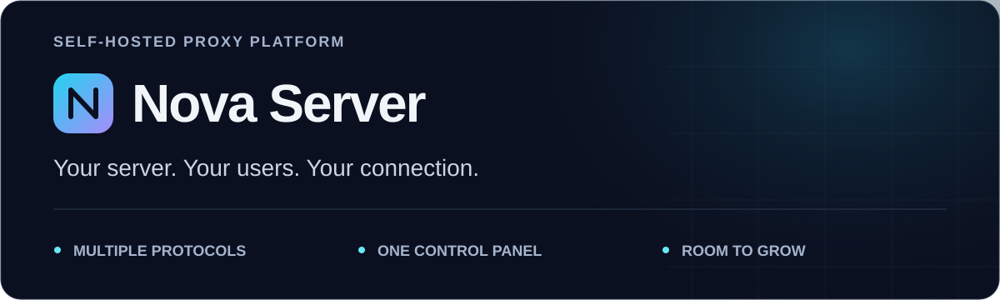

<div align="center">

<a href="README.fa.md">فارسی</a> | <strong>English</strong>



**A self-hosted proxy platform built for restricted networks.**

Run multiple proxy protocols, manage users and servers, and deliver personal subscriptions
from one panel. Built with Iran's network conditions in mind, with an English, Persian,
and Russian interface.

[](https://github.com/IRNova/Nova-Server/releases/latest)
[](LICENSE)
[](https://github.com/IRNova/Nova-Server/stargazers)

[Install](#quick-install) | [Features](#features) | [Deployment guide](DEPLOY.md) | [Release notes](RELEASE_NOTES.md) | [Community](#community)

</div>

---

<a id="what-is-nova-server"></a>

## What is Nova Server?

Nova Server turns a Linux VPS into a private proxy service that you operate yourself.
One agent manages Xray-core, sing-box, AmneziaWG, and optional standalone services,
alongside the web panel, REST API, and Telegram bot. Start with one server and a
personal account, or manage a fleet with customer plans and reseller access.

**Nova Server is proprietary software.** This public repository distributes packaged
releases, installers, and documentation. The server source is not published here.
[Nova Proxy](https://github.com/IRNova/Nova-Proxy), the separate Cloudflare Worker
project, is open source.

- **A choice of connections:** VLESS with Reality, VMess, Trojan, Shadowsocks,
  Hysteria2, TUIC, NaiveProxy, WireGuard, and AmneziaWG, plus optional mieru and
  Telegram MTProto. Choose protocols and transports for the clients your users run.
- **Guided setup:** a Setup Assistant, a starter account, personal subscription links,
  and QR codes help you get started. Simple and advanced views share the same panel.
- **User and reseller management:** quotas, expiry, device limits, saved plans,
  bulk actions with previews, CSV import/export, and per-user access rules.
- **One panel for multiple servers:** enroll nodes with a panel-generated command,
  place supported inbounds on them, and offer eligible node and bridge addresses
  as subscription fallbacks. AmneziaWG can also be managed on supported fleet nodes.
- **Options for restricted networks:** Iran bridge tunnels, clean Cloudflare IPs,
  client-side fragmentation and ECH options where supported, and three DNS tunnel
  engines. Availability depends on the network, configuration, and client.
- **Personal delivery:** a customer page with usage and app import links, Nova Client
  integration, Telegram MTProto links, and per-customer Telegram web proxy links
  that can use a CDN. These are separate services with separate client requirements.
- **Day-to-day operations:** multiple domains, certificate automation, health checks,
  backups, traffic charts, signed webhooks, Login Guard, two-factor authentication,
  and a support bundle you can inspect before sharing.

The HTTPS front can share TCP port 443 across compatible services. UDP protocols,
WireGuard/AmneziaWG, DNS tunnels, and standalone services may need additional ports.
No protocol or configuration is guaranteed to bypass every network restriction.

---

<a id="quick-install"></a>

## Quick install

On a fresh Ubuntu 20.04+ or Debian 11+ server (x86_64 or arm64), run:

```bash
bash <(curl -fsSL https://raw.githubusercontent.com/IRNova/Nova-Server/main/nova-node.sh)
```

The installer first asks a few short questions:

- **Domain**: if you have one, a free Let's Encrypt certificate is issued for it automatically. No domain is fine too: the node runs on its own IP with a self-signed certificate, and the Nova app connects either way.
- **Panel secret path**: press Enter for a random path, type your own, or use `none` to keep the panel at the root.
- **Extra panel port**: optionally a separate HTTPS port for the panel (for example `2053`). The firewall port is opened automatically.

Then the proxy cores, the panel, and the tunnel backends are set up, every available standard protocol is enabled, and a starter user named `me` is created. Open the printed panel URL and sign in with the admin password printed by the installer. Keep both private.

The **Setup Assistant** opens on the first panel visit. Review its proposed settings before applying them, then follow its domain, bridge, or node setup steps as needed. The dashboard offers a personal subscription link and QR code for your starter account.

A new node starts in **simple mode**: the everyday pages stay on screen and the engine internals are put away, because the wizard configures them for you. One switch in **Settings > Show advanced pages** brings back the routing rule builder, custom outbounds, tunnels, Xray engine options, resellers and API tokens. It changes no setting, only which pages are listed, and a node that predates this release keeps every page it already had.

For a scripted (unattended) install, set everything with environment variables: `NOVA_DOMAIN`, `NOVA_DOMAIN_EMAIL`, `NOVA_PANEL_PATH` (or `none`), `NOVA_PANEL_PORT`, `NOVA_ADMIN_PASS`, and `NOVA_NO_PROMPT=1` to skip all prompts.

Lost the panel URL or secret path? Run `nova-access` on the server. It prints the
current address without changing your password or two-factor authentication.

Forgot the password? Reset it from the server:

```bash
nova-passwd 'YourNewPassword'
```

Only if you have also lost your authenticator, add `--clear-2fa` to that password
reset command. This removes two-factor protection; enable it again after signing in.

Panel unreachable after a domain, Cloudflare, or SSL change? Recover access from the server without the web UI. It prints the current panel URL, and `--reset` reverts to a self-signed no-domain node (everything falls back to the server IP):

```bash
nova-access            # show the current panel URL and TLS mode
nova-access --reset    # revert to a self-signed no-domain node
```

### The panel behind a secret path

Older builds answered the panel directly at the root (`https://server/`). Now every fresh install puts the panel behind a random secret sub-path such as `https://server/p-a1b2c3/`, and unrelated paths return a plain 404, reducing casual panel discovery. This does not replace a strong password, two-factor authentication, or firewall rules. You can change the path any time in **Settings > General > Panel access**, clear it to send the panel back to the root, or give the panel a separate HTTPS port (for example `2053`); the firewall port is opened automatically.

### Multiple domains, subdomains, bridges, and nodes

Open **Domains & addresses** in the panel. The first card controls the one primary domain used by the panel. The **Additional domains** card accepts up to 20 more domains or subdomains for the same server:

1. Point the domain at this VPS, or connect Cloudflare so Nova creates the DNS record.
2. Choose automatic Let's Encrypt, automatic Cloudflare DNS, or paste an existing certificate.
3. Choose **All compatible protocols**, or **WebSocket front only** for a Cloudflare orange-cloud address.
4. Nova validates the certificate and Xray reload before the domain appears in user subscriptions. Failed or pending domains are never published.

Additional server domains are not Iran bridge addresses. A bridge domain must point at its Iran VPS and belongs under **Tunnel > Bridge domains**. A managed-node domain must point at the new node VPS and can be entered before generating its one-command installer on the **Nodes** page.

Xray protocols can select each alias certificate by SNI. Hysteria2, TUIC, and NaiveProxy use sing-box's single server certificate, so Nova adds those aliases only when the primary Cloudflare wildcard certificate is known to cover the subdomain. Otherwise those protocols safely remain on the primary domain.

---

## New here? A step-by-step guide

Never run a server before? This is the whole path, in plain steps. Every technical word is explained the first time it appears.

1. **Rent a VPS.** A VPS is a small computer you rent on the internet that stays on around the clock, so users can connect to it any time. Any provider works; a plain Ubuntu 20.04+ or Debian 11+ box (about 4 to 6 dollars a month) is enough. You do **not** need a domain to start.

2. **Install Nova (pick just one way).**
   - **One command:** open your server's terminal (if you have never used SSH, which is just a way to type commands on the server, most providers have a browser Console button), paste the command from the Quick Install section, and press Enter. It asks a few simple questions; pressing Enter accepts the defaults.
   - **No computer:** paste the same command into your provider's cloud-init or user-data box when you create the server.
   - **Telegram:** the installer bot can do the whole thing for you.

3. **Open the panel and sign in.** The installer prints your panel URL, including its secret path, so save that link. Sign in with the admin password printed by the installer. Lost the link? Run `nova-access` on the server to print the current address.

4. **(Optional) Add a domain and free HTTPS.** A domain (a web address like `vpn.example.com`) and a publicly trusted TLS certificate are optional for basic proxy access. Without them, your node runs on its IP and the Nova app still connects. With a domain, the panel gets a free certificate automatically. You can skip this step and add it later.

5. **Scan and connect.** Nova already created the starter user `me` with access to every available protocol and all-users inbound. On the main dashboard, find **Quick connect** and scan the personal subscription QR with the Nova app, v2rayNG, sing-box, or Clash. You can also copy the same auto-updating link. Add separate users later when you want individual limits or access rules.

6. **Grow whenever you need to.** Add more users with data or time limits, add more entry points on the Inbounds page, stay online under heavy filtering with an Iran bridge or a DNS tunnel, and scale from one panel to many servers (nodes).

The panel itself also carries a more detailed **step-by-step setup guide** inside (at the top of the in-panel help), in English, Persian, and Russian.

---

## Install with Docker

Prefer a container? Nova ships a Docker option as an alternative to the native one-line installer. It is reproducible, easy to stop, move, and upgrade, and your data lives on named volumes that survive a rebuild. The installer and checksum-pinned agent package are bundled into the image, and a recreated container restores its runtime without losing the persistent database or certificates.

Run this on a real Linux VPS as root. It installs Docker if it is missing, builds the image, and brings the node up:

```bash
bash <(curl -fsSL https://raw.githubusercontent.com/IRNova/Nova-Server/main/docker/nova-docker.sh)
```

You get the same installer options as the native path, passed as environment variables: `NOVA_ADMIN_PASS`, `NOVA_DOMAIN`, `NOVA_PANEL_PATH`, and `NOVA_PANEL_PORT`.

Once it is up, find the generated password and panel URL with:

```bash
cd /opt/nova-docker/docker && docker compose logs -f nova-node
```

**Important:** this method needs a real Linux host with host networking. It does **not** work on Docker Desktop for Mac or Windows, because they cannot take the host's port `443` the way a node needs. The container runs systemd inside itself and uses host networking with privileged mode, because a Nova node is a VPN appliance: it takes port `443` (on TCP and UDP), and when needed `53/udp` and a UDP port for WireGuard, and it manages systemd services. Full details are in `docker/README.md`.

---

<a id="iran-bridge"></a>

## Iran bridge tunnels

An Iran bridge gives clients a local address that forwards traffic to your foreign
exit. It needs its own reachable server and a working path to the exit.

- Choose **Backhaul**, **BackPack**, **rathole**, or **wstunnel**.
- Only configured forwarded ports use the bridge, across raw, Clash, and sing-box
  subscriptions. Forwarding TCP 443 alone leaves other protocols direct.
- UDP protocols such as Hysteria2 need explicit UDP forwards and a compatible
  backend configuration; they do not follow a TCP-only forward.
- Multiple bridge addresses provide alternative connection paths for compatible
  clients. Failover depends on the client's selection and health checks.
- The readiness check (`nova-bridge.sh --check`) checks the public address and free
  ports. The panel also offers control-port probes and tunnel diagnostics.

### DNS tunnels for fallback access

DNS tunneling is an optional fallback when ordinary connections are unavailable and
a usable DNS path remains. Performance and reachability vary; it is not a replacement
for a normal high-throughput VPN connection.

Choose one engine on the **DNS tunnel** page:

- **MasterDnsVPN:** the simple default, with a separate client configuration.
- **CottenDns:** DoT/DoH resolver transport, multiple resolvers, and loss recovery.
- **Soar:** Lantern's DNS tunnel, with shared or per-customer mode. Per-customer mode
  gives each granted customer a separate key and usage accounting. Soar carries TCP
  only, to destination ports 80 and 443 by default.

Only one engine uses the DNS listener at a time. Setup needs a subdomain delegated
to your node with an `NS` record and a reachable UDP port 53. Nova can create the
delegation through Cloudflare, or you can follow the manual `A` and `NS` record guide.

Use a compatible client for the selected engine. For Soar delivered in a personal
subscription, use **Nova Client build 238 or newer** with Soar support. Its customer
page also offers a direct profile link and QR code. MasterDnsVPN and CottenDns use
their respective clients and exported configurations. Generic Clash and sing-box
subscriptions do not carry Soar.


---

<a id="add-nodes"></a>

## Manage a fleet

You no longer install a full panel on every server. Install the panel once on your main server and grow the fleet from there:

1. In the main panel, open the **Nodes** page and click **Add node with one command**. Optionally enter a domain already pointing at the new VPS; Nova will request and renew its Let's Encrypt certificate during enrollment.
2. Run the one-liner it gives you on a fresh VPS:

```bash
NOVA_JOIN_URL='https://your-panel' NOVA_JOIN_TOKEN='njt_...' bash <(curl -fsSL https://raw.githubusercontent.com/IRNova/Nova-Server/main/nova-node.sh)
```

The new server installs in **managed-node** mode: it has no standalone panel (just a plain page, with no way to log in), registers itself with the main panel automatically, and from then on everything (users, traffic, all of it) is controlled from the main panel over the node's API. The join token is single-use and expires after 24 hours. This works whether the node has a domain or runs on a bare IP with a self-signed certificate. During registration the node sends its access token over a verified TLS connection to the panel, and if the panel itself has a self-signed certificate the node also pins the panel's key, so the token cannot be sniffed in transit. (If you change or renew the panel's certificate, generate a fresh "add node" command.)

**If registration does not complete**, nothing is lost. If the main panel cannot reach the new node (usually because port 443 on it is not open to the internet yet), the node shows up on the **Nodes** page with a **Pending** status and its reason, and the attempt is logged in the activity feed. Open port 443 on that server and click Test, or add it manually. A node that fails to register is **never locked**: it stays a normal standalone panel so you can retry or manage it, and is never left stranded.

**Users and protocols are central and placed onto nodes.** You never manage a node directly. Create users on the **Users** page and protocols on the **Inbounds** page as usual, and when you add a protocol choose "Run on": this main server, one node, or **all nodes**. The panel pushes that protocol and its assigned users to the chosen node(s), and each user's subscription config uses **that node's IP** to connect through it. On the **Users** page you choose which nodes each user gets: tick specific nodes under **This user's nodes**, or turn on **Access to all nodes** so every node appears in their subscription (one config per location). The node itself just runs `xray` with the config the panel sends, and has no users or inbounds of its own to manage.

**Remove or recover a node.** On the **Nodes** page click **Remove** to drop a node from the fleet. Tick "**Completely remove Nova from that server**" to have the node wipe itself fully (`xray`, panel, and all data). To turn a managed node back into a normal standalone panel (for example when its main panel is gone), run `nova-unlock 'NewPassword'` on that server over SSH. The `nova-uninstall` command also removes Nova from any server at any time.

---

## Login Guard and webhooks

Two operator tools live under **Settings > Security**. That sub-tab appears once **Show advanced pages** is on in Settings, because a new node hides it: Login Guard already defends the panel on its defaults, so there is nothing to do there on day one.

**Login Guard** is a fail2ban-style shield for the panel login. After too many failed attempts from one IP within a window, that IP is blocked for a while, so password guessing gets nowhere. It is on by default, whether or not the page is visible; you can tune the attempt count, the window, and the ban time, and the same page shows every active block with one-click **Unblock** (and **Clear all**).

**Webhooks** send a small signed JSON POST to your own URL when something happens on the node: a user is created, edited, or deleted, expires, or hits quota; a node registers; or an IP is blocked. Add as many URLs as you like, pick the events you want for each (or leave it on all), and set an optional secret. When a secret is set, Nova signs the body with HMAC-SHA256 and sends it in an `X-Nova-Signature: sha256=...` header, so the receiver can be sure the call really came from your node. A **Test** button sends a sample so you can confirm the connection. The payload shape is `{ event, timestamp, node, data }`.

---

<a id="features"></a>

## Features at a glance

| Area | Capabilities |
| --- | --- |
| **Protocols** | VLESS/Reality, VMess, Trojan, Shadowsocks-2022, Hysteria2, TUIC v5, NaiveProxy, WireGuard, and AmneziaWG, including supported 2.0/3.0 modes |
| **Transports** | TCP, WebSocket, gRPC, XHTTP, and HTTPUpgrade; TLS and Reality options where applicable |
| **Standalone services** | Optional mieru, per-customer Telegram MTProto, and per-customer Telegram web proxy links; direct-address and client requirements vary |
| **Users and plans** | Total or split quotas, expiry from creation or first use, device limits, reset schedules, per-user access, saved plans, previewed bulk changes, and CSV import/export |
| **Resellers** | Delegated customer management, sellable plans, balances, and traffic allowances |
| **Subscriptions** | Personal auto-updating links, usage pages, QR codes, and app import links; raw, Clash/Mihomo, sing-box, Nova, Karing, and Xray formats with compatible features only |
| **Client compatibility** | Nova subscriptions can include XHTTP, HTTPUpgrade, mieru, and Soar for supporting Nova Client builds; generic formats omit unsupported entries |
| **Routing and exits** | Domain, geosite, geoip, CIDR, and protocol rules; domestic bypass; direct, WARP/WARP+, Tor, Psiphon, and custom SOCKS/HTTP exits |
| **Network options** | Clean Cloudflare IPs, client-side fragmentation, ECH where supported, and carrier-specific client profiles; results depend on the client and network |
| **Iran bridges** | Backhaul, BackPack, rathole, and wstunnel; multiple bridge addresses, readiness checks, and control-port probes; only configured forwarded ports use the bridge |
| **DNS tunnels** | MasterDnsVPN, CottenDns, or Soar; automatic Cloudflare delegation or manual NS setup; shared or per-customer Soar with compatible clients |
| **Domains and TLS** | Primary and additional server domains, separate bridge domains, and optional node domains; Let's Encrypt, Cloudflare DNS validation, or a pasted certificate; renewal and activation checks |
| **Fleet** | One-command enrollment with verified or pinned TLS, central users and usage, supported inbound placement, and AmneziaWG on supported nodes |
| **Security** | Random panel path, optional separate HTTPS port, Login Guard, owner/reseller roles, two-factor authentication, and server-side recovery tools |
| **API and Telegram** | Token-authenticated REST API, Telegram management bot, Mini App, and optionally HMAC-signed event webhooks |
| **Operations** | Traffic charts, health diagnostics, backups, updates, service logs, factory reset, and a redacted support bundle to review before sharing |
| **Interface** | English, Persian RTL, and Russian; Setup Assistant, simple/advanced navigation, search, in-panel guides, and light/dark themes |


---

<a id="how-it-compares"></a>

## Nova Server and Nova Proxy

Choose **Nova Server** when you want to operate your own Linux servers, manage users
and nodes, and choose from multiple proxy cores. It is distributed as proprietary,
packaged software and needs a VPS you control.

Choose [**Nova Proxy**](https://github.com/IRNova/Nova-Proxy) for the separate,
open-source Cloudflare Worker project. It runs on Cloudflare rather than managing
a Linux server. Check that project's documentation for its current limits.

---

<a id="architecture"></a>

## Architecture

Ports and services depend on the protocols you enable. Xray-core and sing-box run the main proxy protocols; AmneziaWG, mieru, MTProto, and the selected DNS tunnel engine are managed separately when enabled.

The agent is a single Node.js process backed by a local SQLite store. The panel, the REST API, and the Telegram bot all drive the same internal service functions.

---

## Requirements

- A VPS running **Ubuntu 20.04+** or **Debian 11+** (x86_64 or arm64)
- **Root** access
- A **domain** is optional for basic proxy access; trusted HTTPS, the Telegram Mini App, and DNS tunnels have their own domain requirements

---

## Updating

The panel checks for new versions and updates in one click, or turn on **automatic updates**. Users, inbounds, and settings are all preserved.

---

<a id="community"></a>

## Community

[Website](https://novaproxy.online/) | [Telegram channel](https://t.me/irnova) | [Telegram group](https://t.me/irnova_group) | [YouTube](https://www.youtube.com/@novaproxyir) | [X](https://x.com/irNovaProxy) | [Instagram](https://www.instagram.com/irnova_team) | [Donate](https://donate.novaproxy.online)

---

<div align="center">

Crafted with care for a free and open internet.

**Nova Server. All rights reserved.**

<a href="https://star-history.com/#IRNova/Nova-Server&Date">Star history</a>

</div>
